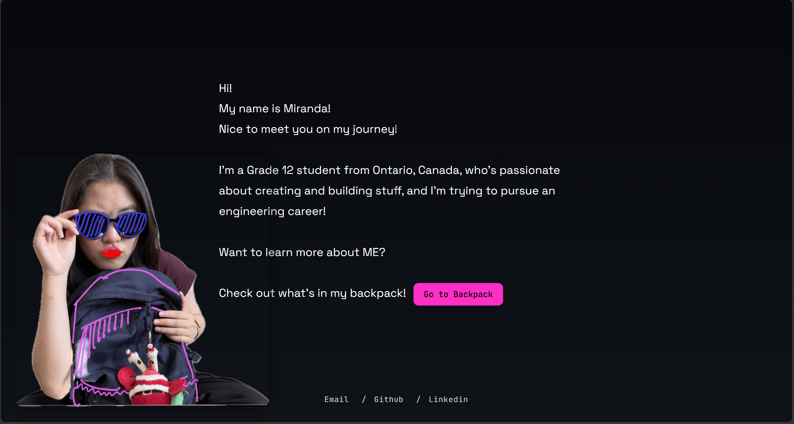
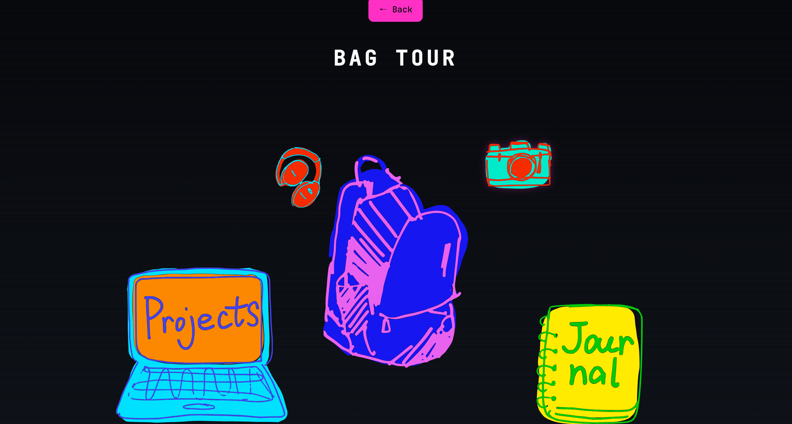
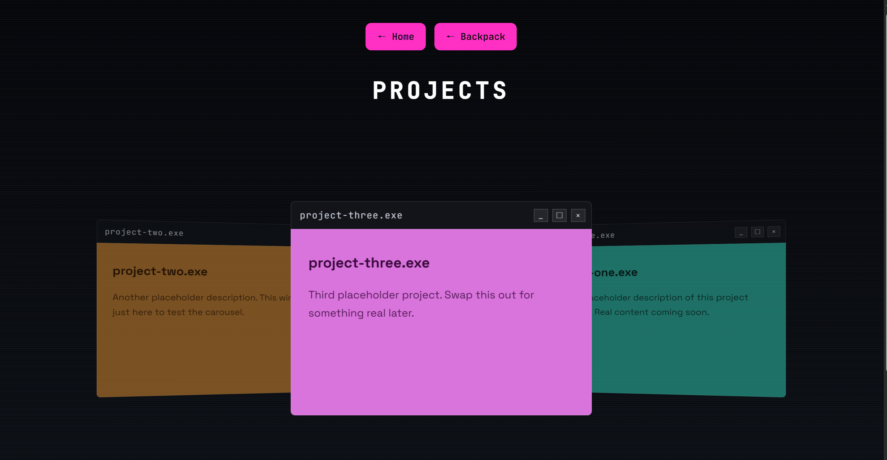
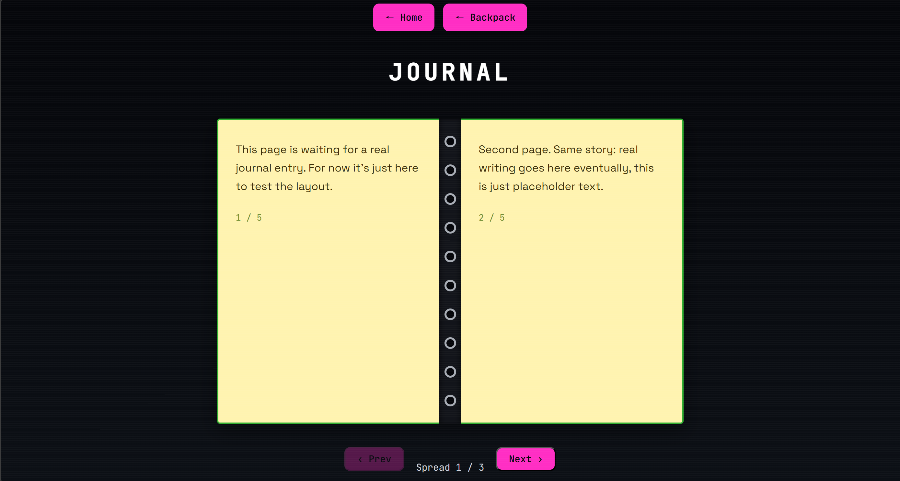

# Miranda's Journey

## Screenshots

### Home



### Backpack Opening



### Projects



### Journal



## How it Works

[Check out my personal portfolio!](mirandayong.com)

## About

My personal portfolio! Inspired by the concept that life is a journey. By leading visitors through the items in my bag along the journey (inspired by Dora the Explorer), they get to learn more about my projects, experiences, and taste.

## Features

- Bag Tour design as menu
- Journal for stories of experiences
- Computer window sliding design to demonstrate projects
- Hand-draw elements serve as buttons

## Tech Stack

- Pure HTML / CSS / JavaScript
- Font: Space Grotesk、JetBrains Mono
- `vectorize_lineart.py`：Python script that uses the `potracer` library to vectorize my hand-draw jpgs into pngs for animation.

## Project Structure

```
index.html          Main page (self introduction and button to the backpack)
project.html         Project demonstration
experience.html      Journal demonstration
visual-art.html       backpack style menu
coming-soon.html     in building pages
css/style.css        style
js/main.js            Typing animation + word arrangement on the first page
vectorize_lineart.py  Vectorizating the hand-draw images
assets/               the storage of pictures
```

## What's Next

- Fill the projects and experiences page with real content
- develop the music (headphone) and photography (camera) pages
- Improve the current animation to make it into real SVG stroke animaiton.
- Figure out better background
